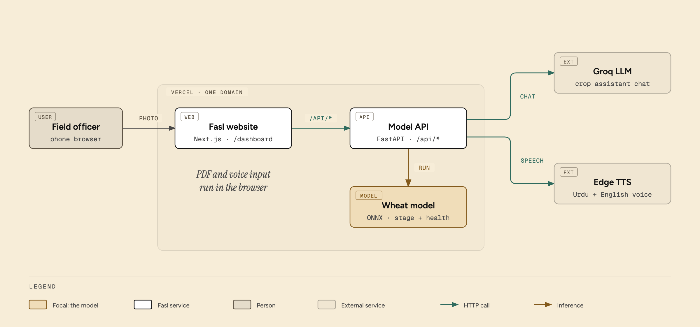
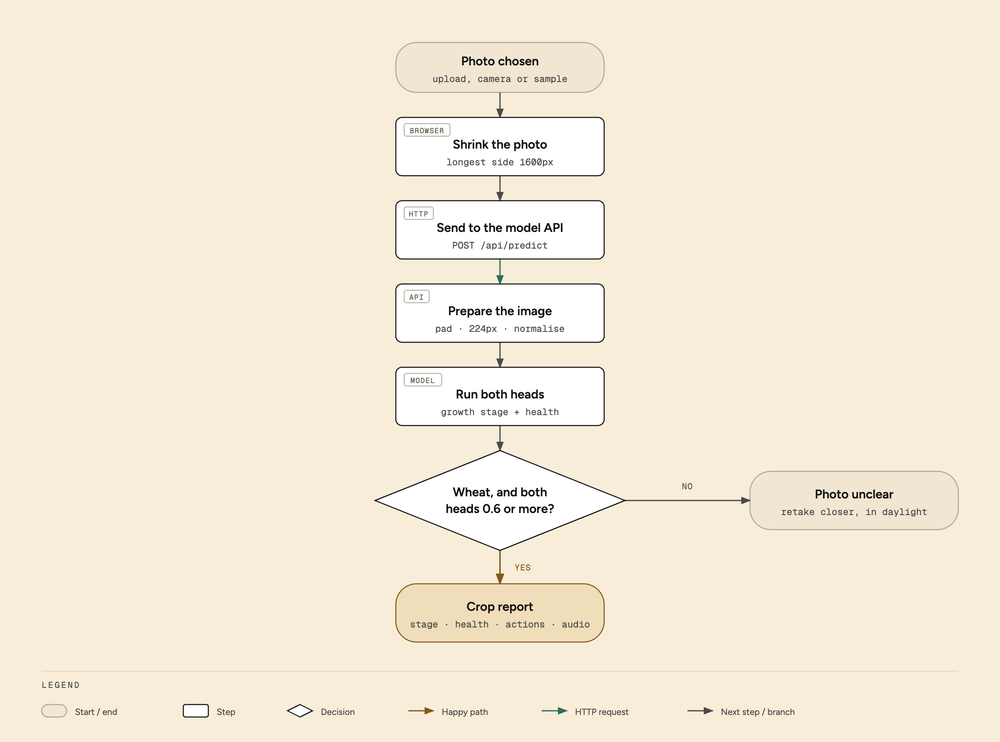
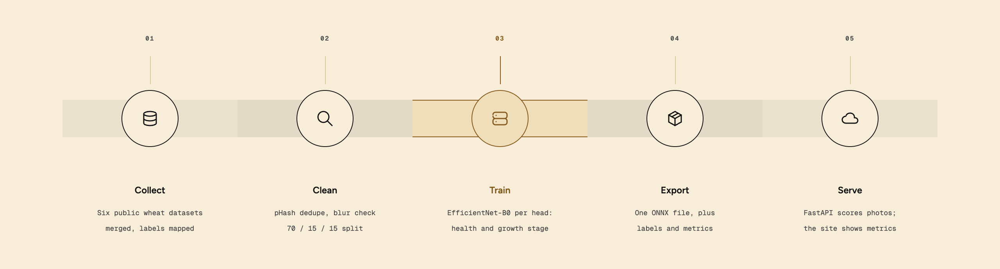

# Fasl (فصل)

**Know your crop from one photo.** Fasl is a web app for Pakistan's agricultural departments, such as NARC, and their field officers. An officer takes or uploads one photo of a wheat crop, and a machine-learning model returns a clear report: growth stage, harvest readiness, health or disease, and what to do next. The report can be read aloud in Urdu, saved as a PDF, and discussed with a crop assistant by text or voice, in English or Urdu.

Built at the GDG PAF IAST x TIMETABLR Hackathon 2026.

- **Live site:** https://fasl-six.vercel.app
- **Dashboard:** https://fasl-six.vercel.app/dashboard

---

## Contents

- [What it does](#what-it-does)
- [How it works](#how-it-works)
- [What happens to one photo](#what-happens-to-one-photo)
- [The model](#the-model)
- [API](#api)
- [Report format](#report-format)
- [Tech stack](#tech-stack)
- [Project structure](#project-structure)
- [Run it locally](#run-it-locally)
- [Deploy on Vercel](#deploy-on-vercel)
- [Update the model metrics](#update-the-model-metrics)
- [Design and accessibility](#design-and-accessibility)
- [Credits](#credits)

---

## What it does

### The website (`/`)

| Section | What it shows |
|---|---|
| Hero | A full-screen wheat field drawn on canvas. The stalks sway and part around the cursor to reveal the headline. |
| The problem | Why crop checks are slow and late today, told with scroll animation. |
| Dashboard preview | A sample report, the same layout the real dashboard uses. |
| Model performance | Real numbers from the training run: accuracy, macro F1, the confusion matrix, per-class scores and training curves. |
| Footer | An illustrated Pakistani farm, with farmers harvesting and oxen ploughing, and wheat that bends away from the cursor. |

### The dashboard (`/dashboard`)

1. **Choose a photo.** Take one with the phone camera, upload one, or pick one of three sample photos.
2. **Read the report.** You get the crop, growth stage (Vegetative, Flowering, Grain filling, Ripening), harvest readiness, health or disease, and a short list of what to do now. Each answer shows the model's confidence.
3. **Listen in Urdu.** The report summary is spoken by a Pakistani Urdu neural voice.
4. **Download the report** as a branded PDF.
5. **Ask the crop assistant.** You can chat about this report by typing or speaking, in English or Urdu, and replies can be read aloud.

If the photo isn't wheat or the model isn't sure, the dashboard shows **Photo unclear** and asks for a closer daylight photo instead of guessing.

---

## How it works



- **One domain, two services.** `vercel.json` deploys the Next.js site (`web`) and the Python API (`api`, the `ml/` folder) together. Every `/api/*` request goes to the API, so the site and the API share an address and need no CORS setup in production.
- **The model API** is FastAPI. It loads the 32 MB ONNX model on the first scan rather than at start-up, so chat and voice requests start fast.
- **The crop assistant** sends the question, the current report and the chat history to `/api/chat`. The API answers with a Groq-hosted LLM (`openai/gpt-oss-120b` by default) and is told to stick to the report and never invent numbers or diagnoses.
- **Speech** comes from Microsoft Edge neural voices (`ur-PK-UzmaNeural` for Urdu, `en-US-AriaNeural` for English) through `/api/tts` and `/api/audio`.
- **In the browser:** the PDF is drawn with jsPDF, and voice input uses the browser's Web Speech API.

---

## What happens to one photo



- Big phone photos are shrunk to a longest side of 1600 px before upload. The model only needs 224 px, and Vercel caps request bodies at 4.5 MB.
- The API pads the photo to a square with the training mean colour, resizes it to 224 × 224 and normalises it, exactly as the training notebook's evaluation transform does.
- One ONNX file has two heads: **growth stage** (4 classes) and **health** (8 classes, including `not_wheat`).
- A photo becomes **Photo unclear** if the health head says `not_wheat`, or if either head is below 0.6 confidence.
- The model decides the facts and `ml/api/report.py` only phrases them. It does not predict severity, lesion location or days to harvest, so live reports leave those out. `readiness.ready` is true only at the ripening stage.
- The three sample photos use saved results and never call the model, so the dashboard demo works even with no API connected.

---

## The model



Two EfficientNet-B0 classifiers (timm, ImageNet-pretrained) are packed into one ONNX file. Training runs in two Kaggle notebooks:

- `ml/notebooks/01_collect_and_clean.ipynb` merges six public datasets, maps their labels, resizes, removes duplicates with perceptual hashing, drops blurry photos and splits 70 / 15 / 15.
- `ml/notebooks/02_train.ipynb` trains both heads, evaluates on the held-out test set, and exports `fasl_wheat.onnx`, `labels.json` and `training_metrics.json`.

### Results (held-out test set, model `fasl-wheat-v0.1`)

| Head | Classes | Test images | Accuracy | Macro F1 |
|---|---|---|---|---|
| Health | healthy, brown rust, yellow rust, stem rust, septoria, loose smut, powdery mildew, not wheat | 1,491 | 96.7% | 0.942 |
| Growth stage | vegetative, flowering, grain filling, ripening | 71 | 90.1% | 0.938 |

- 7,317 training images in total (6,973 health, 344 growth stage).
- CPU inference takes about 20 ms per image.
- The weakest health class is stem rust (F1 0.76, 45 test images).
- The stage test set is small (71 images, only 2 vegetative), so treat its numbers as rough.

The datasets and the cleaned image folder are not committed. The list of sources is in `ml/metrics/training_metrics.json`. More detail is in [`ml/README.md`](ml/README.md).

---

## API

All routes live under `/api`.

| Method | Route | What it does |
|---|---|---|
| `GET` | `/api/health` | Returns `{ "ok": true, "model_version": "..." }`. The dashboard uses it to show "Model online". |
| `POST` | `/api/predict` | Takes `multipart/form-data` with an `image` field, up to 10 MB. Returns a report, or `{ "status": "unclear" }`. |
| `POST` | `/api/chat` | Takes `{ message, language: "en" \| "ur", report, history }` and returns `{ reply }`. Needs `GROQ_API_KEY`. |
| `POST` | `/api/tts` | Takes `{ text, language }` and returns `audio/mpeg`. |
| `GET` | `/api/audio?language=&text=` | The same speech, as a link. Reports use it for `urduAudioUrl`. |

The website times requests out after 30 seconds.

---

## Report format

`POST /api/predict` returns this shape. The TypeScript type is in `lib/demo/types.ts` and the JSON schema is in `ml/schemas/report.schema.json`.

```json
{
  "crop": { "name": "Wheat", "confidence": 0.98 },
  "stage": { "index": 2, "name": "Flowering", "total": 4, "confidence": 0.86 },
  "readiness": { "ready": false },
  "health": { "status": "disease", "disease": "Brown (leaf) rust", "confidence": 0.91 },
  "actions": [
    "Check nearby plants for orange-brown pustules on the leaves.",
    "Confirm the diagnosis with your local agriculture extension officer before spraying."
  ],
  "urduAudioUrl": "/api/audio?language=ur&text=..."
}
```

- `stage.index` counts from 1: Vegetative, Flowering, Grain filling, Ripening.
- `health.severity`, `health.location` and `readiness.daysLeft` are optional. The live model leaves them out, and only the sample reports include them.
- A photo the model can't read returns `{ "status": "unclear", "message": "Photo unclear. Retake it closer, in daylight." }`.

---

## Tech stack

| Part | Tools |
|---|---|
| Website | Next.js 16 (App Router), React 19, TypeScript, Tailwind CSS 4 |
| Animation | Canvas 2D (wheat field and farm scene), GSAP with ScrollTrigger, Motion |
| Charts and PDF | Recharts, jsPDF |
| Icons | lucide-react |
| Model API | Python 3.11+, FastAPI, ONNX Runtime, NumPy, Pillow |
| Assistant and speech | Groq (LLM), edge-tts (neural voices), Web Speech API (voice input) |
| Training | PyTorch, timm (EfficientNet-B0), Kaggle notebooks |
| Hosting | Vercel (site and API on one domain) |

---

## Project structure

```
app/
  page.tsx                 # the website: hero, problem, dashboard preview, performance, footer
  dashboard/page.tsx       # the working dashboard
components/
  hero/                    # canvas wheat field with cursor reveal
  problem/                 # scroll-animated problem story
  dashboard/               # scan flow, report panel, model status, crop assistant
  demo/                    # photo picker, analysing state, report blocks, PDF and audio buttons
  performance/             # confusion matrix, per-class scores, training curves
  footer/                  # painted farm scene, swaying wheat, stamp logo
  shared/                  # section headers, tabs, decorative wheat stalks
lib/
  apiUrl.ts                # where the API lives (same domain by default)
  demo/                    # predict client, report helpers, sample results, PDF report
  assistant/               # chat client, speech input and playback
  wheat/, scene/           # stalk physics and farm-scene drawing
  metrics.ts               # types for public/metrics.json
public/
  metrics.json             # model metrics shown on the site
  samples/                 # sample photos, Urdu audio clips, credits
ml/
  api/                     # FastAPI: main, model, report, chat, tts
  models/fasl_wheat.onnx   # the trained model
  config/labels.json       # class order, image size, normalisation, threshold
  notebooks/               # data cleaning and training (Kaggle)
  metrics/                 # raw training export
  scripts/to_web_metrics.py
  schemas/report.schema.json
docs/
  01-hero.md ... 06-ml-model.md   # section specs
  diagrams/                # the diagrams in this README (HTML source + PNG)
vercel.json                # deploys the site and the API as two services on one domain
```

---

## Run it locally

You need Node.js and Python 3.11 or newer.

### Website only

```bash
npm install
npm run dev
```

Open http://localhost:3000. The sample photos work without the API.

### Website and model API

Start the API from the repo root:

```bash
uv pip install -r ml/pyproject.toml   # pip cannot read pyproject.toml directly
uvicorn ml.api.main:app --reload --port 8000
```

Then copy `.env.example` to `.env.local`, set `NEXT_PUBLIC_API_URL=http://localhost:8000`, and run `npm run dev`. The chat assistant also needs `GROQ_API_KEY` in the API's environment.

Or run both the way Vercel does, with no `.env.local` needed:

```bash
vercel dev
```

### Environment variables

| Variable | Where | What it does |
|---|---|---|
| `NEXT_PUBLIC_API_URL` | Website | Only set it to use an API on another address, such as `http://localhost:8000`. Leave it empty on Vercel. It is read at build time. |
| `GROQ_API_KEY` | API | Enables the crop assistant. |
| `GROQ_MODEL` | API | Optional. Defaults to `openai/gpt-oss-120b`. |
| `ALLOWED_ORIGINS` | API | Comma-separated origins for CORS. Defaults to `http://localhost:3000`. Not needed on Vercel. |
| `FASL_MODEL_PATH`, `FASL_LABELS_PATH` | API | Optional. Override where the model and labels are loaded from. |

---

## Deploy on Vercel

1. Import the repository into Vercel. `vercel.json` sets up both services.
2. Add `GROQ_API_KEY` to the project's environment variables.
3. Deploy. The site and the API come up together on one domain, with `/api/*` routed to the API.

The `ml/deploy/` folder also has Docker files for running the API as a Hugging Face Space instead.

---

## Update the model metrics

After retraining, copy the new export to `ml/metrics/training_metrics.json`, then run:

```bash
python ml/scripts/to_web_metrics.py
```

This rewrites `public/metrics.json`, which the Model performance section reads. The headline accuracy and F1 are the health head's test numbers.

---

## Design and accessibility

- **Palette:** wheat-tint `#F7EDD8`, wheat `#E3C07E`, wheat-deep `#B8893D`, black `#121212`, charcoal `#4A4A4A`. Wheat colours are fills only, never text on white.
- **Type:** Figtree for headings and UI, and Noto Nastaliq Urdu for فصل and all Urdu text.
- **Accessibility:** body text meets 4.5:1 contrast, and every section works at 375 px wide. `prefers-reduced-motion` turns off the sway, reveal and scroll animations. The HTML is semantic, with labelled icon buttons.
- **No made-up numbers:** every figure on the site comes from the real training run.
- **Specs:** each section was built from its spec in `docs/`, and `CLAUDE.md` holds the project rules.

### Demo tips

- On the dashboard's photo picker, press `U` to show the "Photo unclear" screen on purpose.
- The sample photos work with no model connected.

### Diagrams

The diagrams in this README were made with the [diagram-design](https://diagramdesign.dev/) skill in Fasl's colours. Their sources are in `docs/diagrams/`: open any `.html` file in a browser, or rebuild them with `python3 docs/diagrams/build_diagrams.py docs/diagrams`.

---

## Credits

- **Team:** Hassan Mahmood and Hashir Sakimdad.
- **Photos and audio:** see [`public/samples/CREDITS.md`](public/samples/CREDITS.md). The heatmaps on the sample reports are hand-drawn illustrations, not real Grad-CAM output.
- **Datasets:** six public wheat datasets, listed in `ml/metrics/training_metrics.json`.
